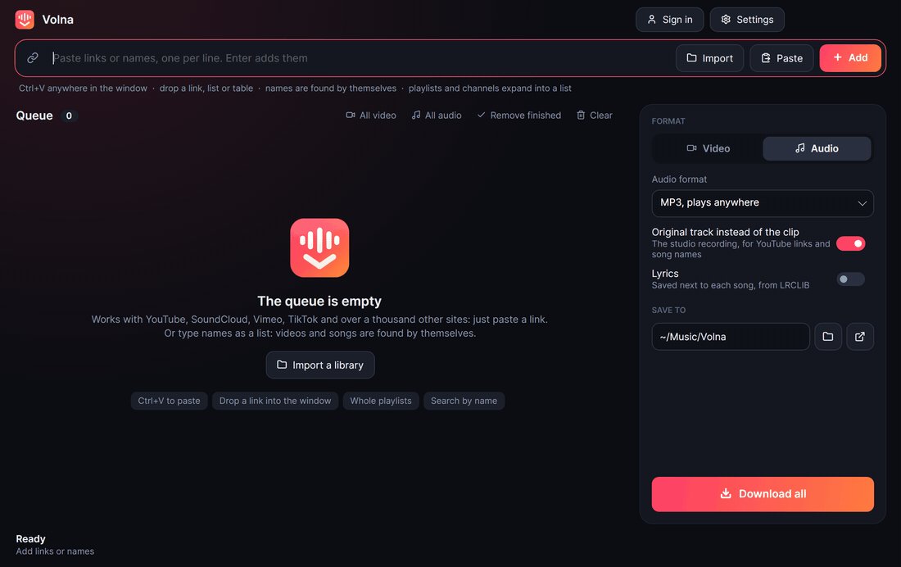
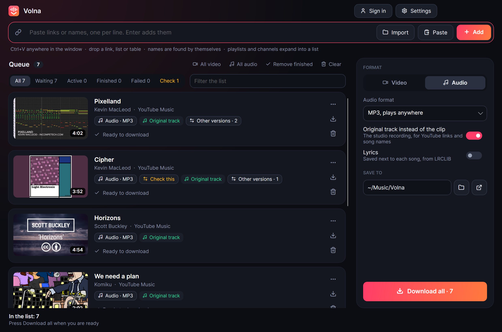
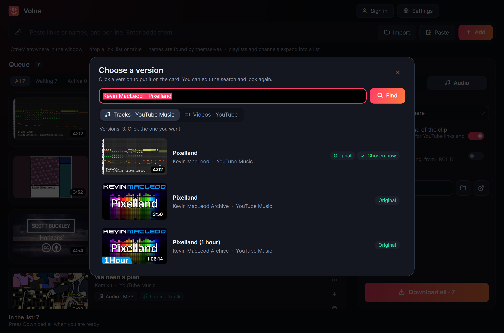
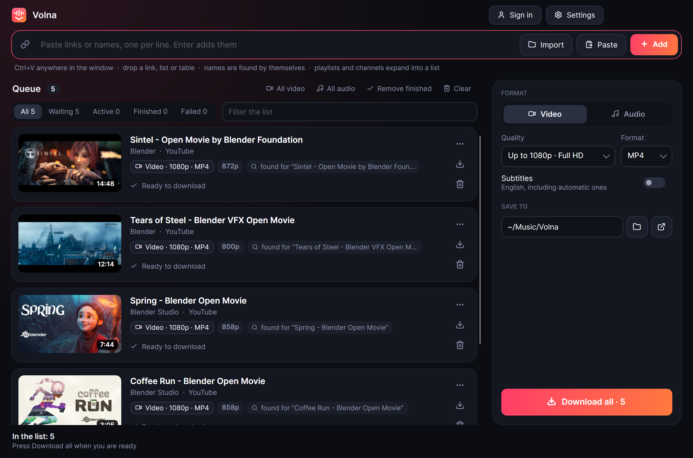
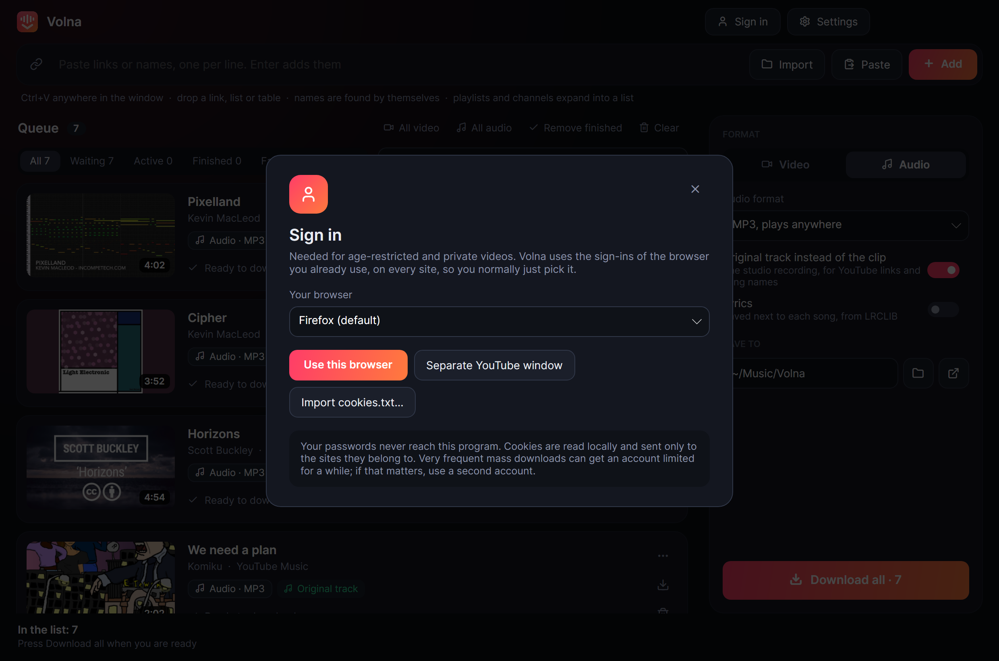

# Volna

Find video and music by name or link, check each match, download. For Windows, macOS and Linux.

**[Download the latest release](../../releases/latest)**



## What it does

- **Video, your way.** Links from YouTube and over a thousand other sites, whole playlists and channels, up to 8K. Each card can have its own quality, and subtitles include automatic ones.
- **Names work like links.** Paste `1. Artist - Song` lines, numbered or not, and each one is found for you. A list of 1,500 is fine.
- **Bring a list from anywhere.** Any table with names in it works, from any service or script: you see how it was understood before anything is searched. Exports from Exportify, TuneMyMusic and Soundiiz, Spotify account data, Apple Music and M3U need not even that. No login to any of them, and playlists come along as playlist files.
- **It points at what to check.** A wrong song is the real risk in a long list. Cards whose length or title do not fit, or whose name several artists share, are marked and collected under one filter, with other versions a click away.
- **The recording, not the clip.** For audio it prefers the studio recording from YouTube Music, without a video's intros and sound effects. When a song has none, it uses the video and cuts the non-music parts where SponsorBlock knows them.
- **It repairs itself.** Sites change often and that is what breaks downloaders. Volna keeps yt-dlp fresh, and when a download fails in a way a newer version may fix, it updates and tries again by itself.
- **Made for long lists.** Filters, search within the queue, retry of everything that failed. The queue survives closing the app. Searching is deliberately unhurried and pauses by itself if a site asks.
- **Far more than YouTube.** SoundCloud, Vimeo, TikTok, Twitch, Bandcamp, and [everything else yt-dlp supports](https://github.com/yt-dlp/yt-dlp/blob/master/supportedsites.md): paste a link, nothing to configure.
- **Your browser's sign-ins.** For age-restricted and private videos it uses the browser you already use. There is no account to create, and your passwords never touch the app.
- **Only the part you want.** Thirty seconds from a twelve-hour stream download as thirty seconds, not twelve hours. Find the moment by its frames, or paste a link with a time in it.
- **In your language.** The interface follows your system's language, in 15 of the most used ones. Subtitles come in the video's own language: the author's, or else the automatic ones, never a machine translation.
- **Small things that add up.** Lyrics next to each song, playlists that stay up to date, the original soundtrack on dubbed videos, and no second copy of what you already have.
- **AI assistants can use it.** A built-in [MCP](https://modelcontextprotocol.io/) server lets models search, download, read transcripts and look at video frames.

| | |
| --- | --- |
|  |  |
|  |  |

## Install

Download the file for your system from the [latest release](../../releases/latest). Nothing else is needed: on first start Volna fetches [yt-dlp](https://github.com/yt-dlp/yt-dlp), [FFmpeg](https://ffmpeg.org/) and [Deno](https://deno.com/) from their official releases (about 450 MB on disk) and checks their published checksums where available.

| System | File | Then |
| --- | --- | --- |
| **Windows** 10/11 | `Volna-…-win-x64.zip` | Unpack and run `Volna.exe` |
| **macOS** 12+ | `…-osx-arm64.zip` (Apple silicon), `…-osx-x64.zip` (Intel) | Move `Volna.app` to Applications |
| **Linux** | `…-linux-x64.tar.gz`, `…-linux-arm64.tar.gz` | Unpack and run `./install.sh`, or just `./Volna` |

The app is not yet signed with a paid certificate, so the first start shows a warning:

- **Windows:** in "Windows protected your PC", choose *More info*, then *Run anyway*.
- **macOS:** open it once and close the warning, then choose *Open Anyway* in *System Settings → Privacy & Security*. On macOS 14 and older, right-click the app and choose *Open*. Or run `xattr -dr com.apple.quarantine /Applications/Volna.app`.

Linux needs a graphical desktop with fontconfig, and `xz` to unpack FFmpeg during setup; almost every desktop distribution has them.

Video previews use LibVLC, included in the Windows and macOS packages. On Linux, install your distribution's VLC runtime (on Debian/Ubuntu: `sudo apt install libvlc5 vlc-plugin-base vlc-plugin-video-output`). Downloads and frame previews work without it. A playable preview fetches only the selected part, choosing a lower resolution when available, up to its first two minutes; its temporary file is removed when the preview is closed.

## How to use it

1. **Add** links or song names. Paste with <kbd>Ctrl</kbd>+<kbd>V</kbd> anywhere, press <kbd>Enter</kbd> in the box, drop in a link or a `.txt` list, or simply copy a video link in your browser while *Catch copied links* is on.
2. **Choose** Video or Audio on the right. Any single card can differ: click its format chip.
3. Press **Download all**. You can press it straight away; whatever is still being looked up downloads when it is found.

Links work from any site [yt-dlp supports](https://github.com/yt-dlp/yt-dlp/blob/master/supportedsites.md). Song names are searched on YouTube and YouTube Music. `Artist - Song` matches far better than a song name alone: common titles such as "Closer" or "Stay" may otherwise find someone else's song, and nothing can tell that it is not the one you meant.

### Moving a library

Get a file from where your music is now, then press **Import** or drop it into the window:

| From | How |
| --- | --- |
| **Spotify** | [Exportify](https://exportify.app/) gives a CSV per playlist. Or request your data in Spotify's privacy settings and use `YourLibrary.json` and the `Playlist` files |
| **Apple Music** | *File → Library → Export Library* |
| **YouTube Music** | [Google Takeout](https://takeout.google.com/) |
| **Anything else** | Any table: a CSV from [TuneMyMusic](https://www.tunemymusic.com/) or [Soundiiz](https://soundiiz.com/), your own script's output, or a spreadsheet pasted with <kbd>Ctrl</kbd>+<kbd>V</kbd>. If its columns are not obvious, Volna shows how it read them and lets you correct that |

A zip or a whole folder works too. The ISRC and length in the file help to find the same recording. Press **Check** above the list to see what may be wrong: click a card's mark to compare versions, or right-click it if the match is right. Songs already in the folder under their plain name are skipped, and each playlist gets an `.m3u8` file next to the songs.

### Also useful

A card's format chip chooses audio or a video quality for that card alone. Its **Part** chip picks a stretch of the video on a strip of its frames, and downloads only that; a link with `t=` in it starts there. Its **⋯** menu has **Follow this playlist**: a followed playlist is checked once a day and its new videos download by themselves. <kbd>Ctrl</kbd>+click, <kbd>Shift</kbd>+click or <kbd>Ctrl</kbd>+<kbd>A</kbd> selects several cards, and an action on one then applies to all of them. **Lyrics** in the audio options saves a text file next to each song; the song's name goes to [LRCLIB](https://lrclib.net/) to find it. **Settings** has the rest, such as clean file names without the video's id.

### Choosing several parts

Open a card's **Part** chip. The existing timeline and start/end fields still choose a single range.
Give it an optional name and press **Add to list**; repeat for other moments, then **Download all parts**.
Each range becomes its own queued download and file. The list stays available if you close and reopen
the dialog during the same session.

- **Chapters** lists the video's chapters when available. Click one to select its range, or check several
  and add them to the list.
- **Words** loads the video's available captions. Choose a language and search for a phrase; clicking a
  passage selects its time range, which you can adjust before adding or downloading. Captions can be
  unavailable, and automatic captions can contain mistakes.
- **Preview with sound** prepares only the selected range, at a lower resolution when available, and plays it inside Volna.
  Long selections preview their first two minutes. Pause, continue, mute or stop without adding a
  download to the queue. Changing the range or closing the dialog stops playback and removes the
  temporary preview.

### Signing in

Most things need no account. For age-restricted and private videos, press **Sign in** and choose your browser. That is all: Volna uses that browser's sign-ins for every site, reading them when it needs them, so nothing is copied and nothing goes stale. If you have only just signed in to a site in Firefox, close Firefox once first, because it saves new sign-ins when it closes.

- **Chrome and other Chromium browsers on Windows** do not let other programs read their sign-ins. Use *Separate YouTube window*: it opens that browser with its own profile, where you sign in to YouTube once. For other sites, import a `cookies.txt`.
- **Safari** needs Full Disk Access for Volna in System Settings.

Very frequent mass downloading can get an account limited for a while. If that matters to you, use a second account.

## For AI assistants

`volna-agent` is an [MCP](https://modelcontextprotocol.io/) server, and it comes with the app. For Claude Desktop, Cursor, LM Studio and others, add it to the MCP settings:

```json
{
  "mcpServers": {
    "volna": { "command": "/full/path/to/volna-agent" }
  }
}
```

On Windows the path is written with double backslashes, as in `"C:\\Programs\\Volna\\volna-agent.exe"`. On macOS it is `/Applications/Volna.app/Contents/MacOS/volna-agent`. On first use it installs the same tools as the app, which takes a few minutes.

| Tool | What it does |
| --- | --- |
| `youtube_search` | Find videos, or original tracks with `source=music` |
| `video_info` | Description, chapters, tags, subtitle languages |
| `get_transcript` | What is said in a video, without downloading it |
| `download`, `download_status`, `cancel_download` | Fetch audio or video, by link or by name |
| `list_downloads`, `media_info` | What is there, with durations, codecs and tags |
| `extract_frames` | Stills from a video, returned as images the model can see |
| `extract_audio_clip` | A short speech-ready MP3, for a recognizer or an audio model |
| `account_status` | Whether the person has signed in, and where files go |
| `list_playlist` | The videos of a playlist or a whole channel, without downloading them |
| `download_list` | Many downloads at once, up to 5,000 links or names |

Links in `download` and `video_info` can be from any site yt-dlp supports.

Without MCP, the same tools work from a command line and print JSON: `volna-agent --help`.

A model can open only media in the downloads folder named the way Volna names it, cannot sign in, and never sees cookies. Titles and transcripts are written by strangers, and the server tells the model to treat them as data, but that lowers the risk rather than removing it. Take care when also giving the model tools such as email.

## Where things are stored

| | Windows | macOS | Linux |
| --- | --- | --- | --- |
| Settings, queue, tools, logs | `%LOCALAPPDATA%\Volna` | `~/Library/Application Support/Volna` | `~/.local/share/volna` |

Downloads go to `Downloads/Volna` unless you choose another folder. Set `VOLNA_DATA` to keep the data elsewhere, for example on a portable drive.

## Build from source

You need the [.NET 10 SDK](https://dotnet.microsoft.com/download).

```bash
dotnet run --project src/Volna.App                     # the app
dotnet test tests/Volna.Tests                          # the tests
dotnet run --project tools/Demo -- smoke                  # renders the interface without a screen
tools/package.sh linux-x64                                # a release package in dist/
```

See [CONTRIBUTING.md](CONTRIBUTING.md) for how the code is laid out. Translations are especially welcome: a language is one file in [`src/Volna.Core/Strings`](src/Volna.Core/Strings).

## Please use it responsibly

Volna is a tool, and what you do with it is up to you. Download only what you have the right to: your own work, openly licensed material, or content you have permission for. Respect copyright law where you live and the terms of the sites you use.

Volna is not affiliated with or endorsed by YouTube or Google. It does not bypass DRM or paid access. It relies on [yt-dlp](https://github.com/yt-dlp/yt-dlp) for sites and uses YouTube Music's public web interface for song search, either of which can change without notice. If something stops working, try **Update yt-dlp** first.

## License

Copyright (C) 2026 kon9. Volna is free software under the [GNU General Public License, version 3](LICENSE): you may use, change and share it, and a changed version you share must be under the same license, with its source.

For use under other terms, such as in a closed product, ask for a separate license through [GitHub](https://github.com/kon9).

The tools it downloads and the components it includes have their own licenses: see [THIRD-PARTY-NOTICES.md](THIRD-PARTY-NOTICES.md).
